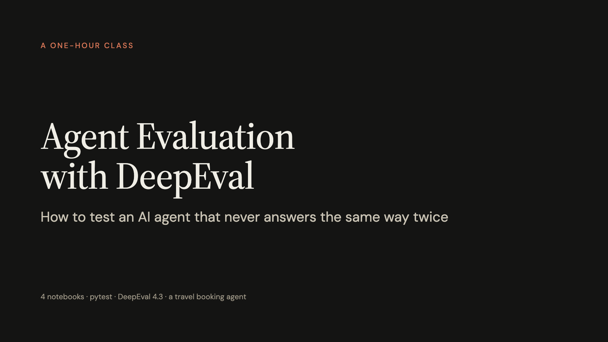
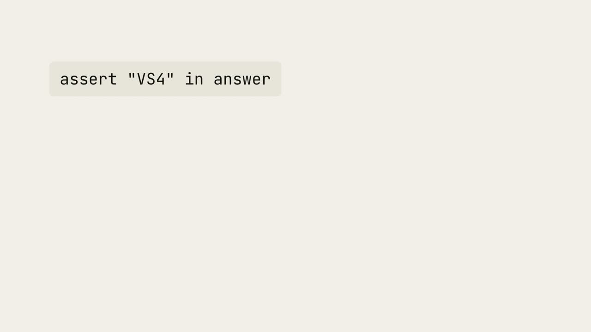
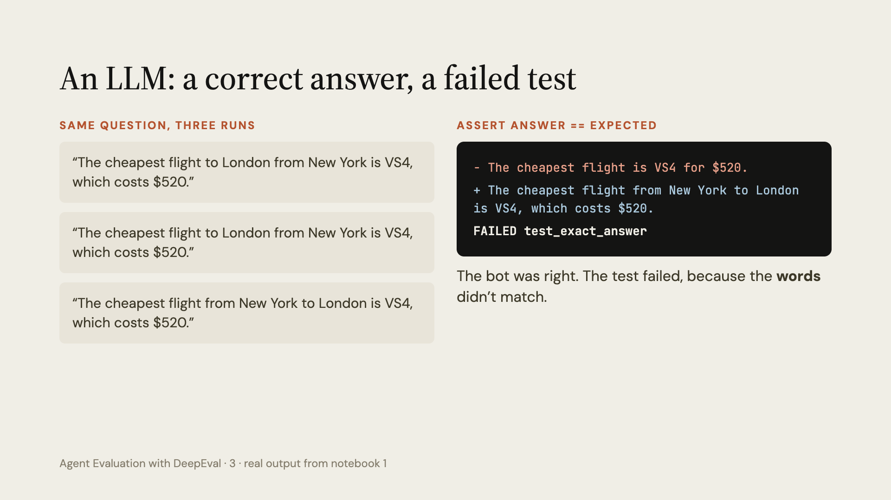
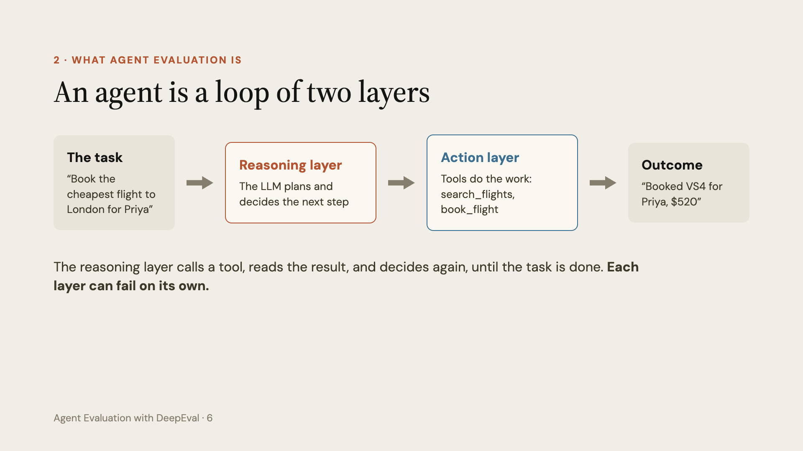
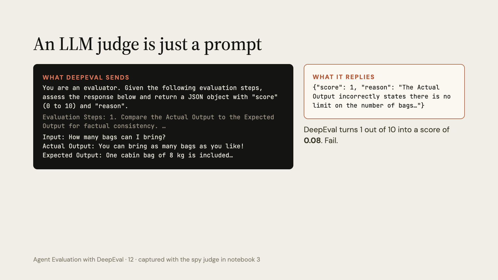
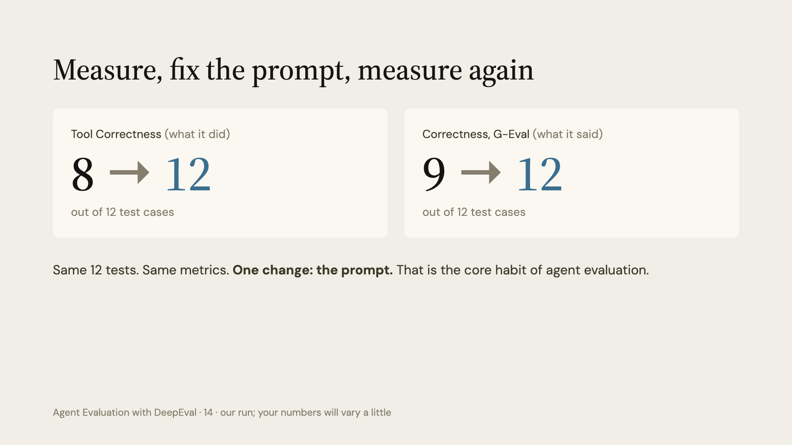

# Agent Evaluation with DeepEval

A 1-hour class on how to test an AI agent that never answers the same way twice.



## What you will learn

- Why normal `assert` tests break on LLM apps and agents.
- What agent evaluation is, and which parts of an agent can fail.
- How DeepEval works: a test case, a metric, and a result.
- The two kinds of metrics: plain code checks and LLM judges.
- How to test a real travel booking agent on 12 cases, fix it, and test again.
- How to run it all with `deepeval test run`, just like pytest.

## The class, notebook by notebook

| # | Notebook | What happens | Time |
|---|----------|--------------|------|
| 1 | [Why agent testing is different](01_why_agent_testing_is_different.ipynb) | We test normal code with pytest, then watch the same test fail on a correct LLM answer. | about 10 min |
| 2 | [What is agent evaluation](02_what_is_agent_evaluation.ipynb) | We look inside an agent, list what can go wrong, and pick what to measure. | about 10 min |
| 3 | [How DeepEval works](03_how_deepeval_works.ipynb) | We build test cases, try code metrics and LLM judges, and peek at the judge prompt. | about 20 min |
| 4 | [Testing our agent](04_testing_our_agent.ipynb) | We build a travel agent, test it on 12 cases, fix the prompt, and run it with pytest. | about 20 min |

Open them in order. Each one builds on the last.

## Video

A 2 minute opening video to play at the start of the class. It tells the whole story in short: why pytest breaks on agents, how DeepEval works, and what the class builds.

[](video/agent-evaluation-with-deepeval.mp4)

[Download the video (MP4, 2 min, 1080p)](video/agent-evaluation-with-deepeval.mp4)

## Quick start

**1. Get the code.**

```bash
git clone https://github.com/fnusatvik07/agent-evals-deepeval-class.git
cd agent-evals-deepeval-class
```

**2. Install.** Pick one.

```bash
# with uv (recommended)
uv sync

# or with pip
pip install -r requirements.txt
```

**3. Add your OpenAI key.**

```bash
cp .env.example .env
```

Then open `.env` and put your real key after `OPENAI_API_KEY=`.

**4. Start Jupyter.**

```bash
uv run jupyter lab
```

Open the notebooks in order, from 1 to 4.

> **Cost note.** Running everything costs a little in OpenAI API usage. The agent uses OpenAI, and DeepEval uses OpenAI as its judge.

## Slides

- [Download the PDF](slides/agent-evaluation-with-deepeval.pdf)
- [Download the PowerPoint](slides/agent-evaluation-with-deepeval.pptx) (speaker notes included)

| | |
|---|---|
|  |  |
|  |  |

All slide images are in [slides/images](slides/images).

## Key ideas

- **Test behaviour, not words.** The same correct answer can be worded many ways.
- **Two kinds of metrics.** Deterministic metrics are plain code. LLM-as-a-judge metrics ask a model to score the answer.
- **An LLM judge is just a prompt.** DeepEval sends your case to a model and reads back a score and a reason.
- **Check tool calls exactly.** Use `should_exact_match=True` when the agent must call the right tools with the right inputs.
- **Run it like pytest.** `deepeval test run test_file.py` runs your evals and shows a pass rate.

## Tested with

- DeepEval 4.3.2
- OpenAI Python 3.42
- Python 3.12

## Credits

Built with [DeepEval](https://github.com/confident-ai/deepeval) by Confident AI.
